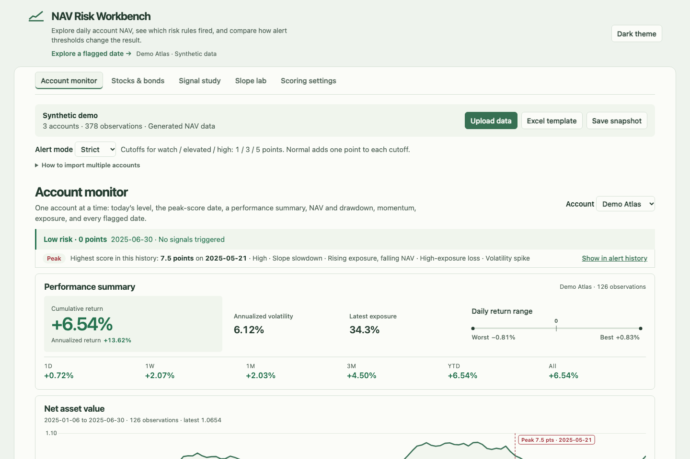

# NAV Risk Workbench

Explore daily account NAV, drawdown and exposure in a browser. Hover over a flagged date to see which rules fired, then compare how Strict and Normal modes classify the same observation. The demo starts with three synthetic accounts and runs entirely on your device.

**[Open the interactive demo](https://suzanneisgenius.github.io/nav-risk-workbench/)** · [Download the standalone HTML](https://raw.githubusercontent.com/Suzanneisgenius/nav-risk-workbench/main/index.html) · [Demo CSV](data/demo-accounts.csv) · [Demo SQLite database](data/demo.sqlite)

## Quick start · inspect one alert

1. Open the demo and select **Demo Atlas** in the account monitor. Leave the score profile on **Balanced**.
2. In **Alert history**, find **May 30, 2025**. Exposure was **49.35%**, and NAV fell **0.59%** from the previous observation. Two rules fired: *Rising exposure, falling NAV* and *High-exposure loss*.
3. Switch from **Strict** to **Normal** and check the same row. Its score stays at **3.0**. Strict classifies it as **Elevated**, while Normal classifies it as **Watch**.



## Read the account report

The NAV chart marks signal dates along its time axis. The drawdown chart below it measures the distance from the running peak. Use the five worst drawdowns to inspect the length and depth of individual declines.

The **Performance metrics** section shows all 17 measures for the selected account and date range.

| Returns | Risk | Drawdown | Exposure |
| --- | --- | --- | --- |
| Cumulative and annualized return, best and worst day, share of positive days | Annualized volatility, Sharpe, Sortino, daily 95% VaR and CVaR | Maximum and current drawdown, longest drawdown, Calmar | Latest, average and peak exposure |

Each recorded observation counts as a session. **Positive days** is the share of daily returns above zero. The default annualization uses 252 sessions per year. Sharpe and Sortino use a zero risk-free rate. Historical daily VaR is the 5th percentile of observed returns and CVaR is the mean in that lower tail. Open **Calculation notes** beneath the metrics for the active settings.

## Alert modes

Both modes use the same observations, six configurable rules, raw scores, return series, drawdowns and slopes. Mode determines the point total required to enter each alert level. Strict uses the configured cutoffs. Normal adds one point to each cutoff.

| Balanced profile | Watch | Elevated | High |
| --- | ---: | ---: | ---: |
| Strict (default) | 1 | 3 | 5 |
| Normal | 2 | 4 | 6 |

For example, a score of **3.0** is **Elevated** in Strict and **Watch** in Normal. Below the Watch cutoff, the level is Low. A score equal to a cutoff enters that level. Selecting a different preset or editing a rule updates the active cutoffs shown beside the selector. The independent slope lab uses its own fixed thresholds.

## Bring your own accounts

A minimal CSV can contain just these three columns:

```csv
account,date,nav
Test North,2025-01-06,1.000
Test North,2025-01-07,1.003
Test South,2025-01-06,1.000
Test South,2025-01-07,0.995
```

Choose **Upload data** and select your CSV, XLSX or XLS files. For a workbook with optional exposure fields, choose **Excel template**. The importer reads every worksheet with a recognized header. Put multiple accounts in one table, split them across sheets, or select several files together.

| Column | Meaning |
| --- | --- |
| `account` | Account identifier. If the column is absent, the filename without its extension identifies the series. |
| `date` | Observation date. Use ISO `YYYY-MM-DD` for portability. Excel date cells are supported. |
| `nav` | Positive unit NAV. Supply NAV, positive equity, or both. |
| `eq` | Account equity. Equity-only histories are rebased to their earliest positive equity. A row with both equity and NAV can anchor a mixed series. |
| `cap` | Capital in use, in the same currency units as equity. Used to derive exposure when risk is missing. |
| `risk` | Exposure percentage. `35`, `35%` and `0.35` mean 35%. Use an explicit percent sign for low values such as `0.5%`. |

The first successful import replaces the demo accounts. Further imports merge on **account and date**. For repeated keys, the last incoming row replaces the earlier row. Files in one selection are applied together. The importer reports skipped rows and retains the current workspace if a selected file has no usable observations. Missing dates stay missing. Exposure-dependent rules require exposure data.

Enable **Scoring settings → Enable combined NAV** to select the combined series in the monitor. **Combined NAV** averages rebased account NAVs with equal starting weights. It starts at 1 on the earliest date shared by every account and uses only common dates. The combined series is computed for display and excluded from signal-study counts. “Multi-account” refers to monitoring multiple account series together in one local browser session.

**Save snapshot** downloads a standalone HTML file containing the open workspace's data, scoring settings and mode. Uploads are processed in memory. Reload the original demo to return to the generated accounts.

## Other workspace views

| View | What you can do |
| --- | --- |
| Signal study | Compare the worst return over the next five observations after a signal with the baseline across eligible account observations. Only complete forward windows contribute; windows can overlap. |
| Slope lab | Paste a single NAV or equity series and inspect 3-, 5- and 10-observation slopes. The lab uses fixed gap thresholds independent of the account score. |
| Scoring settings | Adjust the six rules, select a preset, enable combined NAV, or calibrate rule weights on the loaded sample. Calibration is in-sample. |
| Stocks & bonds | Explore a separate SPY/IEF course study with 5,536 aligned historical returns. Compare 30-, 90- and 252-session rolling correlations and export a selected period. [Open the study](https://suzanneisgenius.github.io/nav-risk-workbench/#stockbond) |

## Reproduce the demo

`data/demo.sqlite` contains the table `observations` with primary key `(account, date)`. The CSV contains the same rows. The page embeds a snapshot of SQLite at build time. No database server is required.

```sh
python3 scripts/make_demo.py
python3 scripts/build.py
node tests/analytics.cjs
```

The Python scripts use the standard library. `src/` holds the editable HTML, styles and JavaScript. Open the rebuilt `index.html` directly or serve the directory as a static site.

## Data and credits

- **Account monitor.** The published account series, tool example and Excel template are generated demonstration data. All account-specific statistics are calculated from the currently loaded records.
- **Stocks & bonds.** The historical market snapshot is independent of the account demo. It retains the SPY/IEF return series from the course project by Joylyn Qiao and Zun Cao. The original notebook used Yahoo Finance adjusted closing prices. [Course notebook](https://github.com/Wirepullerrr/Comprehensive-analysis-of-U.S.-stock-and-bond-market/blob/main/Presentation%20CS329E.ipynb)
- **Bundled libraries.** Chart.js 4.4.1 renders the charts. SheetJS Community Edition 0.20.3 reads and writes workbooks. License texts are in `vendor/`. [Chart.js](https://www.chartjs.org/) · [SheetJS](https://docs.sheetjs.com/docs/getting-started/installation/standalone/)
